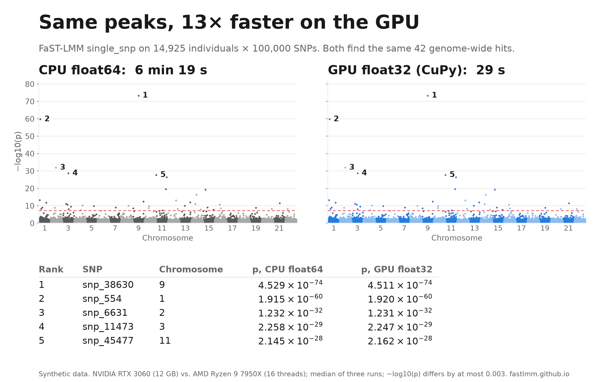

GPU benchmark
=============

On a synthetic GWAS dataset with 14,925 individuals and 100,000 SNPs, FaST-LMM's
``single_snp`` ran **13 times as fast** on a consumer GPU in float32 as on a
16-core CPU in float64, with essentially the same p-values.

The GPU speed comes from `CuPy <https://cupy.dev/>`_, the NumPy-compatible array library for
NVIDIA GPUs. CuPy runs FaST-LMM's matrix products and eigendecomposition through
NVIDIA's cuBLAS and cuSOLVER libraries.

         and the GPU in float32 (29 seconds). The two plots look identical.

.. list-table::
   :header-rows: 1
   :widths: 40 20 20

   * - Configuration
     - Seconds
     - Speedup
   * - CPU, float64 (the default)
     - 379
     - 1×
   * - CPU, float32
     - 154
     - 2.5×
   * - **GPU, float32**
     - **29**
     - **13×**

Times are medians of three runs after a warm-up run; the runs varied by less than
5%.

What was measured
-----------------

One complete ``single_snp`` call: reading the genotypes, building the kernel from all
100,000 SNPs, its eigendecomposition, fitting heritability (h2), and testing all
100,000 SNPs. It used one kernel (``leave_out_one_chrom=False``), with no
covariates beyond the intercept.

The data is synthetic, so anyone can regenerate it: two populations, common SNPs
(minor allele frequency 0.05 to 0.5), 1% missing genotypes, and a phenotype with
1,000 small-effect and 20 large-effect SNPs.

Setup:

* GPU: NVIDIA GeForce RTX 3060 (12 GB), a consumer card.
* CPU: AMD Ryzen 9 7950X (16 cores, 32 threads), using 16 threads, which was
  faster than 8 or 32 in our tests.
* Software: Ubuntu under WSL2 on Windows; FaST-LMM 1.1.0 pre-release code,
  NumPy 2.5.5 and SciPy 1.18.1 (with their bundled OpenBLAS), and CuPy 14.2.0.

Where the time goes
-------------------

.. list-table:: Seconds per stage
   :header-rows: 1

   * - Stage
     - CPU float64
     - CPU float32
     - GPU float32
   * - Read genotypes
     - 1.6
     - 0.9
     - 4.2 [#copy]_
   * - Build kernel
     - 36.8
     - 20.3
     - 4.7
   * - Eigendecomposition
     - 164.9
     - 75.3
     - 11.9
   * - Fit h2
     - 65.9
     - 2.7
     - 0.4
   * - Test SNPs
     - 108.6
     - 54.0
     - 7.1

Smaller stages, such as standardizing the SNPs, take the rest of each total.

.. [#copy] Genotypes are decoded on the CPU and copied to the GPU; the copy is about
   half of this.

Are the results the same?
-------------------------

Yes, for practical purposes. GPU float32 found the same 42 genome-wide significant
SNPs (p < 5×10⁻⁸) as CPU float64, with the same top 100 SNPs. The top five:

.. list-table::
   :header-rows: 1

   * - Rank
     - SNP
     - Chromosome
     - p, CPU float64
     - p, GPU float32
   * - 1
     - snp_38630
     - 9
     - 4.529e-74
     - 4.511e-74
   * - 2
     - snp_554
     - 1
     - 1.915e-60
     - 1.920e-60
   * - 3
     - snp_6631
     - 2
     - 1.232e-32
     - 1.231e-32
   * - 4
     - snp_11473
     - 3
     - 2.258e-29
     - 2.247e-29
   * - 5
     - snp_45477
     - 11
     - 2.145e-28
     - 2.162e-28

Float32 changes p-values slightly. Against CPU float64, the largest difference
in log10(p) over all 100,000 SNPs was 0.0034 for GPU float32 and 0.0017 for
CPU float32. These are observed differences on this dataset, not guarantees; see
:ref:`choosing-precision` for advice.

How big can it go?
------------------

GPU memory, not speed, sets the limit. On a 12 GB card, about 20,000 individuals
fit with a full-rank kernel, or about 50,000 individuals with an 8,000-SNP
low-rank kernel. See :ref:`gpu-memory` for the rule of thumb.

Try it yourself
---------------

Install GPU support (see :doc:`gpu`), then generate the dataset (about a minute,
375 MB) with
`make_synthetic_bed.py <https://github.com/fastlmm/FaST-LMM/blob/main/tools/synthetic-benchmark/make_synthetic_bed.py>`_
from FaST-LMM's GitHub repository::

    python make_synthetic_bed.py --output data

and time it:

.. code-block:: python

    import time
    from fastlmm.association import single_snp

    for xp, dtype in [("cupy", "float32"), ("numpy", "float32"), ("numpy", "float64")]:
        start = time.perf_counter()
        results = single_snp("data/synth_14925x100000.bed",
                             "data/synth_14925x100000.pheno.txt",
                             count_A1=False, leave_out_one_chrom=False,
                             xp=xp, dtype=dtype)
        print(xp, dtype, f"{time.perf_counter() - start:.0f} s")

To choose the CPU thread count, set ``OMP_NUM_THREADS`` before starting Python.
The first GPU call in a process includes a few seconds of CUDA start-up.
